<div align="center">

  <!-- HERO BANNER -->
  <a href="https://github.com/akamuRashina">
    
  </a>

  <p align="center">
    <a href="https://github.com/akamuRashina">
      
    </a>
    <a href="mailto:akamurashi24@gmail.com">
      
    </a>
    
    
  </p>

  <p align="center">
    <strong>Selamat datang di Project Hub & Engineering Monorepo pribadi saya!</strong><br />
    Koleksi proyek perangkat lunak lintas platform — mulai dari aplikasi mobile berbasis <em>Flutter</em>, dashboard web modern berbasis <em>React & Vite</em>, backend enterprise dengan <em>Laravel & FastAPI</em>, hingga integrasi hardware <em>IoT & RFID</em>.
  </p>

  <!-- TECH STACK ROW -->
  <p align="center">
    <a href="https://skillicons.dev">
      
    </a>
  </p>

</div>

---

## 📑 Daftar Isi
- [🌟 Flagship Projects](#-flagship-projects)
  - [1. VokaLog (VoxaLog) — Sistem Monitoring PKL Terpadu](#1-vokalog-voxalog--sistem-monitoring-pkl-terpadu)
  - [2. NEXORA — School Management & Smart Attendance](#2-nexora--school-management--smart-attendance)
  - [3. FlixyGo — Platform Streaming Film, Drama & Anime](#3-flixygo--platform-streaming-film-drama--anime)
  - [4. ReaderTune — Glassmorphism Manga Reader & Music Player](#4-readertune--glassmorphism-manga-reader--music-player)
  - [5. SIBER — Siswa Bersatu Lawan Perundungan](#5-siber--siswa-bersatu-lawan-perundungan)
- [⚡ IoT & Hardware Engineering](#-iot--hardware-engineering)
  - [6. ToolsFlowGraph — Visual Flow & Node-Based IoT Panel](#6-toolsflowgraph--visual-flow--node-based-iot-panel)
  - [7. RFID Smart Attendance — Dual-Tier Offline Engine](#7-rfid-smart-attendance--dual-tier-offline-engine)
- [🌐 Web Applications & Portals](#-web-applications--portals)
  - [8. Web Sekolah & Portal Absensi (Laravel 12)](#8-web-sekolah--portal-absensi-laravel-12)
  - [9. Personal Portfolio Website v2](#9-personal-portfolio-website-v2)
  - [10. Ethereal Romance API — Real-Time Webhook Alert Engine](#10-ethereal-romance-api--real-time-webhook-alert-engine)
- [🏛️ Arsitektur Ekosistem Proyek](#-arsitektur-ekosistem-proyek)
- [📂 Direktori Repositori](#-direktori-repositori)
- [🚀 Panduan Menjalankan Proyek](#-panduan-menjalankan-proyek)
- [📬 Kontak & Kolaborasi](#-kontak--kolaborasi)

---

## 🌟 Flagship Projects

### 1. VokaLog (VoxaLog) — Sistem Monitoring PKL Terpadu
> **Solusi Ekosistem Digital Lengkap untuk Praktik Kerja Lapangan (PKL) & Uji Kompetensi Keahlian (UJIKOM)**

<p align="center">
  
  
  
  
  
  
</p>

VokaLog adalah sistem berskala komprehensif yang menghubungkan 4 aktor utama: **Admin Sekolah/Hubin**, **Guru Pembimbing**, **Pembimbing Industri**, dan **Siswa PKL**. Dibangun untuk menjamin keabsahan kehadiran, transparansi kegiatan harian, dan respons cepat terhadap situasi darurat.

```
📁 Folder Lokasi: /VoxaLog
├── /voxalog          -> Aplikasi Mobile Siswa (Flutter)
├── /vokalog admin    -> Web Portal Multi-Role (React + Vite + Tailwind)
├── /vokalog-firebase -> Cloud Functions, Security Rules & Firestore Config
└── /word, pdf        -> Dokumentasi Teknis, Desain UML & Laporan Ujikom
```

<details>
<summary><b>✨ Fitur Utama VokaLog</b></summary>

- 📍 **Presensi Geofencing & Radius**: Validasi koordinat GPS siswa secara presisi untuk memastikan presensi dilakukan di lokasi industri mitra.
- 📸 **Jurnal & Logbook Harian**: Siswa mendokumentasikan kegiatan kerja harian lengkap dengan unggahan foto bukti real-time.
- 🚨 **Fitur Darurat SOS**: Tombol darurat siswa yang langsung mengirimkan notifikasi prioritas tinggi kepada Guru Pembimbing dan Hubin saat terjadi kendala/kecelakaan di tempat kerja.
- 📊 **Portal Web Multi-Aktor**: Dashboard analitik terpadu untuk verifikasi logbook, rekap kehadiran bulanan, penilaian berkala, dan manajemen kuota siswa per industri.
- 📑 **Automated Report Builder**: Dilengkapi pipeline Python untuk menghasilkan naskah laporan UJIKOM resmi berstandar A4 format Word & PDF secara otomatis.
</details>

---

### 2. NEXORA — School Management & Smart Attendance
> **Aplikasi Manajemen Sekolah & Presensi Terpadu Berbasis Flutter & Firebase**

<p align="center">
  <a href="https://github.com/akamuRashina/Nexora-absensi-students-">
    
  </a>
  
  
  
  
</p>

Aplikasi mobile modern yang menyederhanakan interaksi harian antara sekolah, pendidik, dan peserta didik. Menggabungkan sistem absensi cerdas berbasis lokasi dengan pusat informasi sekolah.

```
📁 Folder Lokasi: /schoolsistem (Mobile App) & /nexora-admin (Admin Dashboard)
```

<details>
<summary><b>✨ Fitur Unggulan NEXORA</b></summary>

- 🎓 **Portal Siswa**:
  - Check-in/check-out absensi dengan verifikasi lokasi GPS & radius batas sekolah.
  - Kalender akademik digital untuk melihat jadwal ujian dan libur sekolah.
  - Portal informasi kegiatan ekstrakurikuler (Ekskul) dan pendaftaran kegiatan.
  - Feed berita & pengumuman resmi sekolah secara real-time.
- 👨‍🏫 **Portal Guru & Tenaga Pendidik**:
  - Rekapitulasi absensi siswa harian dan bulanan per kelas.
  - Publikasi pengumuman dan berita penting sekolah langsung ke ponsel siswa.
  - Monitoring partisipasi ekstrakurikuler serta rekapitulasi data profil siswa.
- 🖥️ **Nexora Admin Dashboard**:
  - Manajemen master data siswa, guru, kelas, dan jurusan.
  - Konfigurasi titik koordinat GPS gerbang sekolah dan batas radius kehadiran.
</details>

---

### 3. FlixyGo — Platform Streaming Film, Drama & Anime
> **Cross-Platform Streaming Client dengan Scraping Engine Cerdas & Supabase Cache**

<p align="center">
  
  
  
  
  
</p>

FlixyGo adalah platform hiburan modern untuk menonton film bioskop, drama Korea, dan serial anime. Dibangun dengan pendekatan arsitektur *scraper-first* yang disinkronisasikan ke Supabase PostgreSQL untuk caching data super cepat.

```
📁 Folder Lokasi: /FlixyGo
├── /flixygo  -> Aplikasi Client Multi-Platform (Flutter)
└── /backend  -> Express.js Scraper API, Cheerio Parser & Supabase Synchronization
```

<details>
<summary><b>✨ Fitur Utama FlixyGo</b></summary>

- 🎬 **Multi-Kategori Lengkap**: Akses instan ke film populer, K-Drama on-going, serial anime musiman, hingga film barat.
- 🔍 **Pencarian Cepat & Cerdas**: Didukung oleh auto-complete dan pengindeksan metadata (poster, genre, sinopsis, rating, rilis).
- 📌 **Watchlist & History**: Sinkronisasi riwayat tontonan dan daftar tontonan favorit pengguna.
- ⚡ **Automated Content Scraper**: Background worker di backend yang secara otomatis memindai sumber streaming dan memperbarui daftar episode terbaru ke database Supabase.
</details>

---

### 4. ReaderTune — Glassmorphism Manga Reader & Music Player
> **Dua Pengalaman Hiburan dalam Satu Aplikasi Elegan (Tachiyomi + Harmony Style)**

<p align="center">
  
  
  
  
  
</p>

ReaderTune menyatukan pengalaman membaca komik (Manga, Manhwa, Manhua) dengan pemutar musik berkualitas tinggi di latar belakang, dibalut desain visual **Glassmorphism** dengan efek blur dan gradien modern.

```
📁 Folder Lokasi: /test24
├── /readertune -> Aplikasi Mobile Flutter (Stitch Manga + Glass Music UI)
└── /backend    -> Server FastAPI (Manga API, Music Scraper, yt-dlp POT Provider)
```

<details>
<summary><b>✨ Fitur Utama ReaderTune</b></summary>

- 📖 **Manga Reader Interaktif**:
  - Dukungan format vertikal (webtoon strip) dan per lembar buku (manga pager).
  - Filter katalog manga, manhwa, dan manhua dengan penomoran bab dinamis.
  - Caching gambar cepat untuk transisi halaman tanpa jeda (*lag-free*).
- 🎵 **Hi-Fi Music Engine**:
  - Pencarian lagu online dengan sistem rekomendasi lagu serupa.
  - Streaming audio langsung di latar belakang (*background audio playback*) sambil membaca komik.
  - Integrasi stream audio YouTube via `yt-dlp pot provider`.
</details>

---

### 5. SIBER — Siswa Bersatu Lawan Perundungan
> **Aplikasi Pelaporan Digital & Konsultasi Anti-Bullying Ramah Siswa**

<p align="center">
  
  
  
  
  
</p>

SIBER dirancang untuk menciptakan lingkungan sekolah yang aman dari tindakan perundungan (*bullying*). Menyediakan ruang aman bagi siswa untuk melaporkan insiden serta berkonsultasi langsung dengan guru BK (*Bimbingan Konseling*).

```
📁 Folder Lokasi: /siberr
```

<details>
<summary><b>✨ Fitur Unggulan SIBER</b></summary>

- 🛡️ **Kanal Pengaduan Terlindungi**: Siswa dapat mengirimkan laporan perundungan secara aman disertai bukti kronologi dan lampiran.
- 💬 **Live Chat Konsultasi Guru**: Saluran komunikasi dua arah antara siswa dan guru pembimbing atau konselor sekolah.
- 📋 **Tracking Status Laporan**: Pemantauan tahapan laporan (`Menunggu Penanganan` hingga `Sudah Diproses/Dibalas`).
- 🌐 **Dukungan Multi-Bahasa**: Sistem internasionalisasi lengkap (`l10n`) mendukung Bahasa Indonesia dan Bahasa Inggris.
</details>

---

## ⚡ IoT & Hardware Engineering

### 6. ToolsFlowGraph — Visual Flow & Node-Based IoT Panel
> **Interactive Canvas Node Graph Controller untuk Otomasi & Telemetri Perangkat IoT**

<p align="center">
  <a href="https://github.com/akamuRashina/tools_flowGraph">
    
  </a>
  
  
  
</p>

ToolsFlowGraph adalah eksperimen antarmuka grafis mutakhir berbasis kanvas sentuh interaktif. Pengguna dapat menghubungkan node sensor, pemroses logika, dan aktuator secara visual layaknya diagram alir (*flowgraph*) untuk mengontrol modul IoT secara dinamis.

```
📁 Folder Lokasi: /toolsflowgraph
├── /lib/pages/canvas_page.dart    -> Kanvas render drag-and-drop node graph
├── /lib/pages/add_panel_page.dart -> Dialog konfigurasi parameter perangkat
└── /lib/models/panel_model.dart   -> Struktur data relasi port & koneksi garis
```

---

### 7. RFID Smart Attendance — Dual-Tier Offline Engine
> **Mesin Presensi Hardware Cerdas dengan SQLite Local Cache & Sinkronisasi Cloud Firestore**

<p align="center">
  
  
  
  
</p>

Sistem presensi perangkat keras (*embedded system*) yang didesain dengan prinsip **Offline-First**. Memastikan proses pemindaian kartu RFID tetap berjalan instan (<50ms) meskipun koneksi internet terputus, lalu secara otomatis menyinkronkan data ke cloud saat jaringan pulih.

```
📁 Folder Lokasi: /testingfiturpython
├── main_rfid.py            -> Engine pembaca RFID, thread background & sync worker
├── rfid_local.db           -> Database SQLite lokal penampung cache pengguna & log
└── serviceAccountKey.json  -> Kredensial Firebase Admin SDK untuk akses Firestore
```

<details>
<summary><b>⚙️ Mekanisme Dual-Tier Sync</b></summary>

1. **Local Instant Verification**: Kartu RFID dipindai → engine mencocokkan `kartu_id` pada SQLite lokal → suara bel/lampu indikator menyala dalam hitungan milidetik.
2. **Offline Logging**: Catatan kehadiran tersimpan di SQLite lokal dengan tanda `synced = 0`.
3. **Background Sync Worker**: Thread background memantau ketersediaan internet; saat online, batch data belum tersinkronisasi diunggah ke Firebase Firestore dan status diubah menjadi `synced = 1`.
</details>

---

## 🌐 Web Applications & Portals

### 8. Web Sekolah & Portal Absensi (Laravel 12)
> **Sistem Informasi Sekolah Komprehensif Berstandar Modern Framework PHP**

<p align="center">
  <a href="https://github.com/akamuRashina/web_sekolah">
    
  </a>
  
  
  
  
  
</p>

Aplikasi portal web resmi sekolah terintegrasi dengan modul absensi digital. Dibangun di atas fondasi Laravel versi terbaru (v12) menggunakan arsitektur MVC bersih, Blade template engine, dan styling Tailwind CSS yang responsif.

```
📁 Folder Lokasi: /web_sekolah & /aplikasi-absensi
```

---

### 9. Personal Portfolio Website v2
> **Showcase Pengembang Interaktif Berdesain Viewport Slide (100vh) & Dark Theme**

<p align="center">
  
  
  
  
</p>

Website portofolio pribadi Luthfi Nur Zaidan yang mengusung filosofi desain presisi satu layar penuh (*no-scroll single viewport*). Dilengkapi animasi SVG ring dinamis, ambient floating blob, profil interaktif, showcase proyek, dan tombol unduh Curriculum Vitae (CV).

```
📁 Folder Lokasi: /portofolio/portofolio
```

---

### 10. Ethereal Romance API — Real-Time Webhook Alert Engine
> **Microservice Notifikasi Cepat Terintegrasi Bot Telegram & Discord**

<p align="center">
  
  
  
</p>

Backend mikro berbasis Python FastAPI untuk melayani event hook interaktif frontend secara hening (*silent event trigger*). Pesan notifikasi langsung diforwarding ke bot Telegram pribadi dan kanal Discord melalui protokol webhook asinkron.

```
📁 Folder Lokasi: /for me again
```

---

## 🏛️ Arsitektur Ekosistem Proyek

Diagram alur berikut mengilustrasikan bagaimana aplikasi client, server API, database cloud, dan perangkat IoT saling terhubung:

```mermaid
flowchart TD
    subgraph CLIENT["📱 Frontend & Client Applications"]
        VokaMob["VokaLog Mobile (Flutter)\n[Siswa PKL: Presensi & Logbook]"]
        NexoraMob["NEXORA Mobile (Flutter)\n[Siswa & Guru: Absensi Sekolah]"]
        FlixyMob["FlixyGo App (Flutter)\n[Streaming Film, Drama, Anime]"]
        ReaderApp["ReaderTune (Flutter)\n[Manga Reader + Music Player]"]
        SiberApp["SIBER App (Flutter)\n[Pelaporan Anti-Bullying]"]
        IoTGraph["ToolsFlowGraph (Flutter)\n[Interactive IoT Node Panel]"]
    end

    subgraph WEB["💻 Web Portals & Dashboards"]
        VokaWeb["VokaLog Admin Portal\n(React 18 + Vite + Tailwind)"]
        NexoraWeb["Nexora Admin Web\n(React + Tailwind)"]
        SchoolWeb["Web Sekolah & Absensi\n(Laravel 12 + Alpine.js)"]
        PortoWeb["Personal Portfolio v2\n(Laravel + Tailwind)"]
    end

    subgraph IOT["📟 Hardware & Embedded Systems"]
        RFID["RFID Physical Reader\n(Python Engine + SQLite Offline Cache)"]
    end

    subgraph BACKEND["⚡ Backend & API Services"]
        FastAPI_Reader["ReaderTune API (FastAPI)\n[Manga Parser + yt-dlp POT]"]
        Node_Flixy["FlixyGo Scraper (Express.js)\n[Cheerio Web Scraper]"]
        EthAPI["Ethereal API (FastAPI)\n[Telegram & Discord Alerts]"]
    end

    subgraph CLOUD["☁️ Cloud & Database Infrastructure"]
        Firebase["Google Firebase\n[Firestore, Auth, Cloud Functions]"]
        Supabase["Supabase\n[PostgreSQL & Content Cache]"]
        MySQL["MySQL Database\n[Laravel MVC Relational Storage]"]
    end

    %% Koneksi Data
    VokaMob <-->|Realtime Sync| Firebase
    VokaWeb <-->|Role-Based Access| Firebase
    NexoraMob <-->|Presence & Feeds| Firebase
    NexoraWeb <-->|Student Master Data| Firebase
    SiberApp <-->|Encrypted Reports| Firebase
    RFID -->|Offline-to-Cloud Sync| Firebase

    FlixyMob <--> Node_Flixy
    Node_Flixy <--> Supabase

    ReaderApp <--> FastAPI_Reader

    SchoolWeb <--> MySQL
    PortoWeb <--> MySQL

    EthAPI -->|Webhook Trigger| DiscordTelegram["Telegram Bot / Discord Channels"]
```



---

## 📂 Direktori Repositori

Tabel direktori berikut memetakan folder proyek di dalam workspace:

| Folder | Nama Proyek | Peran & Deskripsi | Tumpukan Teknologi |
| :--- | :--- | :--- | :--- |
| `📁 VoxaLog/` | **VokaLog (VoxaLog)** | Ekosistem monitoring PKL: Mobile Siswa, Web Multi-Aktor, Firebase | Flutter, React, Vite, Tailwind, Firebase |
| `📁 schoolsistem/` | **NEXORA Mobile** | Aplikasi mobile absensi sekolah berbasis lokasi & informasi akademik | Flutter 3.0+, Dart, Firebase |
| `📁 nexora-admin/` | **NEXORA Admin** | Dashboard manajemen siswa, guru, jadwal, dan geofence sekolah | React, TypeScript, Vite, Tailwind, Firebase |
| `📁 FlixyGo/` | **FlixyGo** | Platform streaming film, K-Drama, dan anime dengan scraper cerdas | Flutter, Express.js, Supabase, Cheerio |
| `📁 test24/` | **ReaderTune** | Aplikasi baca komik (Manga) + pemutar musik Hi-Fi glassmorphism | Flutter, Python FastAPI, yt-dlp |
| `📁 siberr/` | **SIBER** | Sistem pelaporan anti-bullying & konsultasi siswa dengan guru BK | Flutter, Firebase, i18n Bilingual |
| `📁 toolsflowgraph/` | **ToolsFlowGraph** | Visual node-based canvas editor untuk automasi & kontrol IoT | Flutter, Custom Canvas Painter, Dart |
| `📁 testingfiturpython/` | **RFID Engine** | Mesin presensi hardware dual-tier: cache SQLite + sync Firestore | Python 3, SQLite3, Firebase Admin SDK |
| `📁 web_sekolah/` | **Web Sekolah** | Portal informasi profil sekolah dan sistem absensi terintegrasi | Laravel 12, PHP 8.2+, Tailwind CSS, Alpine |
| `📁 portofolio/` | **Portfolio v2** | Website portofolio pribadi Luthfi Nur Zaidan (100vh slider) | Laravel, Tailwind CSS, Vite |
| `📁 for me again/` | **Ethereal Alert** | Microservice alert confession real-time via Telegram & Discord | Python FastAPI, HTTPX, Webhooks |

> ℹ️ *Catatan: Folder `apk_desa` dan `E-Trash` merupakan berkas eksternal dan sengaja dikecualikan dari repositori portofolio ini.*

---

## 🛠️ Core Tech Stack & Tools

<div align="center">

| Kategori | Teknologi & Tools |
| :--- | :--- |
| **Mobile Development** | `Flutter` `Dart` `Material Design 3` `Glassmorphism` `Geolocator` |
| **Frontend Web** | `React` `TypeScript` `Vite` `Tailwind CSS` `Alpine.js` `Blade` |
| **Backend & APIs** | `Laravel 12` `PHP 8.2+` `Python FastAPI` `Express.js` `Node.js` |
| **Databases & Cloud** | `Firebase Firestore` `Firebase Auth` `Supabase (PostgreSQL)` `SQLite3` `MySQL` |
| **IoT & Hardware** | `RFID MFRC522` `Interactive Flow Graph` `Serial / Socket Communication` |
| **DevOps & Tooling** | `Git` `GitHub` `Docker` `Postman` `VS Code` `Android Studio` |

</div>

---

## 🚀 Panduan Menjalankan Proyek

Pilih sub-proyek yang ingin dijalankan di komputer lokal Anda:

### 📱 Proyek Berbasis Flutter (`schoolsistem`, `VoxaLog/voxalog`, `siberr`, `FlixyGo/flixygo`, dll.)
```bash
# 1. Masuk ke folder proyek
cd schoolsistem   # atau cd FlixyGo/flixygo

# 2. Ambil seluruh dependensi Flutter
flutter pub get

# 3. Jalankan di emulator atau perangkat fisik
flutter run
```

### 💻 Proyek Berbasis React + Vite (`VoxaLog/vokalog admin`, `nexora-admin`)
```bash
# 1. Masuk ke folder web admin
cd "VoxaLog/vokalog admin"   # atau cd nexora-admin

# 2. Pasang dependensi Node.js
npm install

# 3. Buat file .env dari template
cp .env.example .env

# 4. Jalankan development server
npm run dev
# Akses di: http://localhost:5173
```

### 🐘 Proyek Berbasis Laravel (`web_sekolah`, `portofolio/portofolio`)
```bash
# 1. Masuk ke folder Laravel
cd web_sekolah

# 2. Pasang dependensi PHP & Node.js
composer install
npm install

# 3. Siapkan environment
cp .env.example .env
php artisan key:generate

# 4. Jalankan migrasi database & server
php artisan migrate
npm run dev
php artisan serve
# Akses di: http://localhost:8000
```

### 🐍 Proyek Berbasis Python (`test24/backend`, `testingfiturpython`, `for me again`)
```bash
# 1. Masuk ke folder backend Python
cd test24/backend

# 2. Buat & aktifkan virtual environment (Opsional)
python -m venv venv
venv\Scripts\activate   # Windows

# 3. Pasang library yang dibutuhkan
pip install -r requirements.txt

# 4. Jalankan server FastAPI
uvicorn main:app --reload --port 8000
```

---

## 📬 Kontak & Kolaborasi

Saya selalu terbuka untuk kolaborasi pembuatan aplikasi web, aplikasi mobile berbasis Flutter, maupun solusi sistem cerdas IoT!

<div align="center">

  [](https://github.com/akamuRashina)
  [](mailto:akamurashi24@gmail.com)
  [](https://github.com/akamuRashina)

  <br />

  

  <sub>Dibuat dengan ❤️ dan dedikasi tinggi oleh <strong>Luthfi Nur Zaidan</strong> • SMKN 1 Sumedang</sub>

</div>
